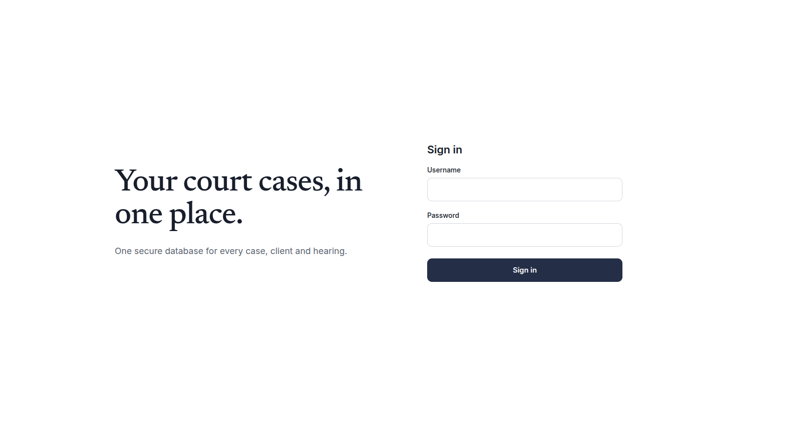
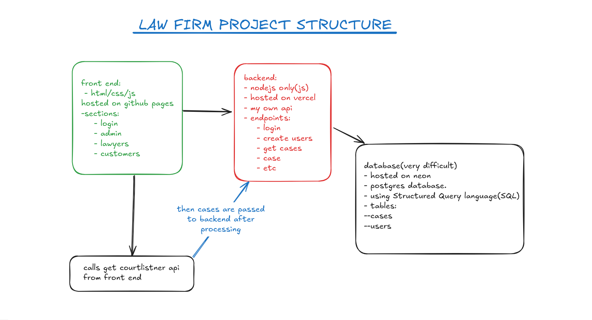

# Law Firm Management System

A web app for managing a law firm's cases and people. Admins fetch court cases from the CourtListener API and save them to the firm's database, then lawyers and customers log in to see only the cases that belong to them.



**Live demo:** 
https://josephnjuguna.github.io/law-firm-management-system/ui/login/login.html

**API:** 

---

## Features

- Role-based login for **admins**, **lawyers** and **customers**
- Admins can create users and view every saved case
- Lawyers and customers see only the cases assigned to them
- Cases are pulled from the CourtListener API, processed, then saved through the backend
- Protected API: every case request checks the logged-in user's session and role

---

## Poroject Flow



**How a case moves through the system**

1. The frontend calls the CourtListener API to fetch cases.
2. The frontend processes the results and passes them to the backend.
3. The backend validates the request and saves the cases to the database.
4. When a user opens their dashboard, the backend returns only the cases they are allowed to see.

---

## Tech Stack

| Layer    | Technology                                   | Hosting      |
| -------- | -------------------------------------------- | ------------ |
| Frontend | HTML, CSS, JavaScript                        | GitHub Pages |
| Backend  | Node.js (plain JavaScript, built-in `http`)  | Vercel       |
| Database | PostgreSQL, queried with SQL                 | Neon         |

---

## Frontend Sections

| Section   | Purpose                                                  |
| --------- | -------------------------------------------------------- |
| Login     | Sign in and get redirected to the right dashboard        |
| Admin     | Fetch and save cases, view all cases, manage users       |
| Lawyers   | View cases assigned to the logged-in lawyer              |
| Customers | View the logged-in customer's own cases                  |

---

## API Endpoints

| Method | Endpoint          | Description                                         | Access                 |
| ------ | ----------------- | --------------------------------------------------- | ---------------------- |
| POST   | `/api/login`      | Log in and start a session                          | Public                 |
| POST   | `/api/addusers`   | Create a new user                                   | Admin                  |
| POST   | `/api/cases`      | Save cases to the database                          | Admin                  |
| GET    | `/api/getcases`   | Get cases (all for admins, own cases for others)    | Logged-in users        |
| GET    | `/api/customers`  | List users with the customer role                   | Logged-in users        |
| GET    | `/api/lawyers`    | List users with the lawyer role                     | Logged-in users        |

### Who sees which cases

| Role     | Cases returned                                  |
| -------- | ----------------------------------------------- |
| Admin    | All cases                                       |
| Lawyer   | Cases where `lawyer_id` is their user id        |
| Customer | Cases where `customer_id` is their user id      |

Unauthenticated requests get `401`. Unknown roles get `403`.

---

## Database

PostgreSQL hosted on Neon, with two tables.

**`users`**

| Column          | Type                | Notes                              |
| --------------- | ------------------- | ---------------------------------- |
| `id`            | SERIAL, primary key |                                    |
| `username`      | TEXT                | Unique, required                   |
| `password_hash` | TEXT                | Required, never store plain text   |
| `role`          | TEXT                | `admin`, `lawyer` or `customer`    |

**`cases`**

| Column         | Type                | Notes                                   |
| -------------- | ------------------- | --------------------------------------- |
| `id`           | SERIAL, primary key |                                         |
| `case_no`      | INT                 | Required                                |
| `date_filed`   | DATE                | Required                                |
| `absolute_url` | TEXT                | Link to the case                        |
| `attorney`     | TEXT                |                                         |
| `case_name`    | TEXT                |                                         |
| `court`        | TEXT                |                                         |
| `status`       | TEXT                |                                         |
| `syllabus`     | TEXT                |                                         |
| `customer_id`  | INT                 | References `users(id)`                  |
| `lawyer_id`    | INT                 | References `users(id)`                  |

`(date_filed, case_no)` is unique, so the same case cannot be saved twice.

Tables are created automatically on server start.

---

## Getting Started

### Prerequisites

- Node.js 20 or newer
- A PostgreSQL database (a free [Neon](https://neon.tech) project works)

### Setup

```bash
git clone https://github.com/JosephNjuguna/law-firm-management-system.git
cd law-firm-management-system
npm install
```

Create a `.env` file in the project root:

```env
DATABASE_URL=your_neon_connection_string
```

### Run locally

```bash
npm run dev
```

The API starts at `http://localhost:3000`. Open the frontend with a static server such as VS Code Live Server, since the Node server only handles `/api/*`.

---

## Deployment

**Backend (Vercel)**

1. Import the repository into Vercel.
2. Add `DATABASE_URL` under Project Settings → Environment Variables (the `.env` file is not deployed).
3. Deploy. The server exports its request handler, so Vercel runs it as a serverless function.

**Frontend (GitHub Pages)**

1. Point the frontend's API calls at your Vercel URL.
2. Enable GitHub Pages in the repository settings and select the branch and folder that contain the HTML files.

---

## Project Structure

```
.
|─ app.js
|─ images/
|─ ui/
│   ─ login/
│   ─ admin/
│   ─ lawyers/
│   ─ customers/
|─ package.json
|─ README.md
|─ index.html

```

---

## Author

**Joseph Njuguna**
[github.com/JosephNjuguna](https://github.com/JosephNjuguna)